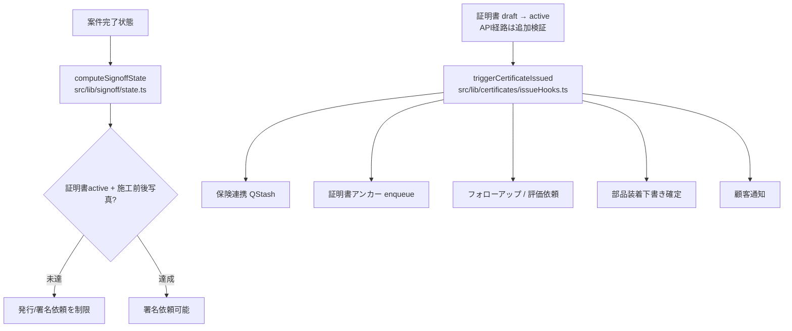

# Ledra コードフロー可視化・変更影響レビュー（導入案）

> Status: proposal / 対象: holy-auto/Ledra / 2026-10-15  
> 本文は設計案。実行時の動作や網羅性を保証するものではない。main への適用前に開発者レビューが必要。

## 目的
新しいコードを追加・変更するとき、既存の処理経路と依存関係を確認し、**維持・統合・削除・延期**を根拠付きで判断する。可視化は次の3層を分離する。

1. **静的依存**: TypeScript import / re-export / 動的 import。コードから自動抽出。
2. **業務処理**: UI → API → 認可 → DB → 非同期ジョブ → 外部連携。重要機能についてソースパスを根拠に手動/半自動で検証。
3. **実行時トレース**: requestId/correlationId を使い、実際に通った API・外部呼び出し・エラーを観測。静的解析と同一視しない。

## 既存資産
- [全体構成図](../diagrams/system-architecture.md)
- [現状アーキテクチャ](../implementation/current-architecture.md)
- [サインオフ状態機械](../../src/lib/signoff/state.ts): `computeSignoffState`
- [証明書発行時の副作用](../../src/lib/certificates/issueHooks.ts): `triggerCertificateIssued`
- [共通ログ](../../src/lib/logger.ts) と [request ID の入口](../../src/proxy.ts)

## 最初の対象：施工完了 → 証明書 → 署名 → 決済 → アンカー

**注意:** これは確認済みの2つの関数の関係を示す概念図で、A→F の呼び出し鎖を実証するものではない。副作用は条件付き・非同期・失敗時に発行を止めない経路がある。特に「発行後の処理が完了した」ことと「enqueue された」ことは異なる。

## Phase 1：静的依存マップ
- `dependency-cruiser` を開発依存として追加する案。既存の `tsconfig.json` の alias を解決。
- 全体を一枚に描かず、`src/lib/certificates`, `src/lib/signoff`, `src/app/api/admin/certificates`, `apps/mobile` などの単位で分割。
- 変更ファイルから **上流の依存元** を抽出し、直接・間接の影響を区別。
- `--affected <base SHA>` でPR差分に関連するモジュールのMermaid図を生成可能。ただし import 以外のDB・webhook・動的ルーティングは別途追跡する。
- 初回はレポートのみ、CI失敗判定を追加しない。大規模グラフはファイル/モジュールを絞る。

## Phase 2：PRごとの変更影響レポート
PRごとに次の表を生成・レビューする。

| 観点 | 確認事項 |
| --- | --- |
| 変更箇所 | 追加/修正/削除したファイルと関数 |
| 静的影響 | import依存元・循環参照・共有モジュール |
| 動的影響 | API route・DB/RLS・cron・QStash・webhook・外部API |
| セキュリティ | tenant境界、権限、個人情報、監査証跡 |
| 運用 | エラー・再試行・冪等性・観測可能性 |
| 判断 | 維持 / 統合 / 削除 / 延期、理由、検証担当 |

**削除判断の原則**: 「参照0件」だけでは削除しない。Next.js のルート自動発見、cron、webhook、SQL/RLS、外部利用者、動的 import を確認する。特にDB migrationは過去履歴なので通常削除しない。

## Phase 3：実行時フロー
- 既存の `x-request-id` と構造化ログを活用し、操作→API→DB/ジョブの相関を追う。
- 非同期ジョブには必要に応じて correlationId を安全に伝播する。
- Sentry等でエラー/遅延を追跡し、必要な範囲でOpenTelemetryのspanを追加。
- 本番ログには個人情報、認証情報、車台番号などを無条件に出さない。
- 機能フロー図では **静的に可能な経路** と **実測した経路** を別色/別レイヤーで表示する。

## 導入順・受入基準
1. 既存ドキュメントと現行ソースを突き合わせる（ルート/API/DB/非同期を確認）。
2. 証明書発行の1フローに限定して静的マップと根拠リンクを作る。
3. 代表的なPRで変更影響レポートを試行し、誤検知・見落としを記録する。
4. CIへ読み取り専用レポート生成を追加し、レビュアーが判断してから拡張する。

受入基準：図の各辺に根拠ファイルがある／推測は明示／PR差分で影響が更新される／未観測の処理を「実行済み」と表現しない／本番動作と秘密情報に影響しない。

## 次の実装PRで追加するもの
- dependency-cruiserの設定と固定バージョン
- 重要モジュールに絞ったグラフ生成スクリプト
- GitHub ActionsのPRサマリー（最小権限、fork PRの安全性確認）
- 必要に応じてHTML可視化（ファイルクリックでGitHubへ遷移）
